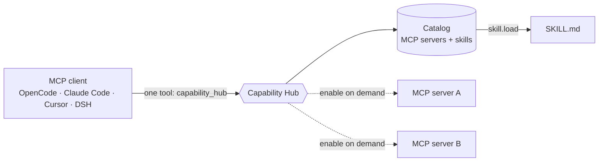
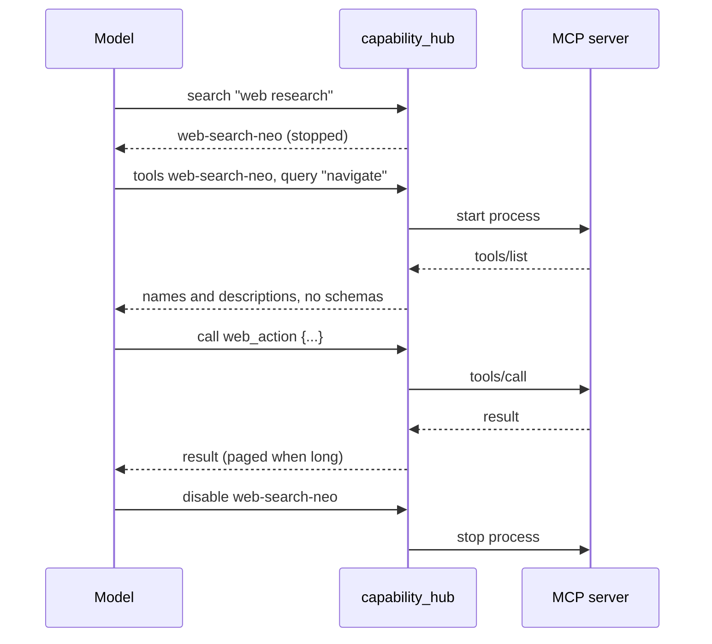

<p align="center">
  
</p>

<h1 align="center">NeoXider MCP Hub</h1>

<p align="center"><strong>One tool in your prompt instead of every schema.<br />MCP servers <em>and</em> skills in one lazy, human-approved catalog — for any MCP client.</strong></p>

<p align="center">
  <a href="https://github.com/NeoXider/neoxider-mcp-hub/actions/workflows/ci.yml"></a>
  
  
  
  
  <a href="https://www.npmjs.com/package/@neoxider/mcp-hub"></a>
  <a href="CHANGELOG.md"></a>
  <a href="LICENSE"></a>
</p>

<p align="center">
  <a href="#quick-start">Quick start</a> ·
  <a href="#connect-your-client">Connect a client</a> ·
  <a href="#one-catalog-for-mcp-servers-and-skills">One catalog</a> ·
  <a href="#measured-results">Measured results</a> ·
  <a href="#how-it-compares">How it compares</a> ·
  <a href="CHANGELOG.md">Changelog</a>
</p>

Every MCP server you configure puts all of its tool schemas into every prompt, whether or not the task touches a tool. Ten servers can cost roughly 15,000 tokens before the model has read your question, and a crowded tool list makes the model pick worse.

NeoXider MCP Hub is a stdio MCP server that exposes **one** tool, `capability_hub`. The model searches a lightweight catalog, inspects permissions, wakes the one server it needs, calls it, and shuts it down again. Skills live in the same catalog and are loaded one at a time, only when selected.

| | |
|---|---|
| **One resident tool** | The host carries about 420 tokens, however many servers you configure. |
| **MCP servers and skills together** | One catalog, one `search`, one trust model. Servers start on demand; skill bodies load one at a time. |
| **Stopped, not just hidden** | A capability is a process that is off until the model asks for it. `disable` stops it. |
| **Human approval** | A model can *propose* a server or a skill. Only a person, outside the model, can approve it. |
| **Any MCP client** | A plain stdio server: OpenCode, Claude Code, Claude Desktop, Cursor, DeepSeek Harness. |
| **Measured, including the losses** | Context, accuracy, a head-to-head and a dynamic proof are reproducible scripts in [`bench/`](bench) — the one where Tool Search wins is published too. |

<p align="center">
  
  <br /><em>Left: every schema resident, every turn. Right: one tool, and the rest wakes on demand.</em>
</p>

## How it works





```text
search → inspect → enable → tools → call → disable
```

- One fixed schema stays in the prompt. Child tool schemas stay outside the model's context until requested.
- `tools` returns names and descriptions by default; full schemas are opt-in. It starts the server itself, so `enable` is optional.
- MCP processes start lazily and live only as long as the hub process.
- Skills are discovered by metadata and loaded one at a time.
- Third-party additions enter a human approval queue; the model cannot approve executable code.

## Quick start

Requirements: Node.js 22.19+ and pnpm.

```powershell
git clone https://github.com/NeoXider/neoxider-mcp-hub.git
cd neoxider-mcp-hub
pnpm install --frozen-lockfile
pnpm test
pnpm client -- --action search --query demo
```

The default catalog contains only a bundled echo MCP and an example ML skill. Tests do not download or execute third-party packages.

The client takes simple requests as plain flags (`--action`, `--query`, `--kind`, `--name`, `--tool`). A request with arguments goes in a file, `pnpm client -- --input request.json`, because Windows PowerShell 5.1 strips the double quotes from inline JSON passed with `--json`.

## Connect your client

The hub is a plain stdio server. Launch it from npm, with nothing to clone or build:

```bash
npx -y @neoxider/mcp-hub --catalog /abs/path/catalog.json --state /abs/path/state
```

Keep your own catalog and state in folders that last. The package's bundled `data/` holds only the demo entries, and under `npx` it sits in a cache that can be cleared, taking your approvals with it. A new catalog can start empty:

```json
{ "version": 1, "entries": [] }
```

From a checkout instead (after `pnpm build`), replace `npx -y @neoxider/mcp-hub` with `node /abs/path/neoxider-mcp-hub/dist/src/server.js`; without `--catalog` and `--state` it then uses the checkout's own `data/` folder. Use absolute paths either way.

### OpenCode

`opencode.json`:

```json
{
  "mcp": {
    "capability_hub": {
      "type": "local",
      "command": [
        "npx", "-y", "@neoxider/mcp-hub",
        "--catalog", "/abs/path/catalog.json",
        "--state", "/abs/path/state"
      ],
      "timeout": 360000,
      "enabled": true
    }
  }
}
```

A call that starts a child server can take a while; raise `timeout` if the client cuts such calls off.

### Claude Code

```bash
claude mcp add capability_hub -- npx -y @neoxider/mcp-hub --catalog /abs/path/catalog.json --state /abs/path/state
```

Every example names the server `capability_hub`, with an underscore. Clients that prefix MCP tools with the server name then show one spelling everywhere, and a model that has seen the tool under one client does not reach for `capability-hub` under another.

### Claude Desktop, Cursor and other `mcpServers` clients

```json
{
  "mcpServers": {
    "capability_hub": {
      "command": "npx",
      "args": ["-y", "@neoxider/mcp-hub", "--catalog", "/abs/path/catalog.json", "--state", "/abs/path/state"]
    }
  }
}
```

On Windows a client that cannot start `npx` directly needs `"command": "cmd"` with `"args": ["/c", "npx", "-y", "@neoxider/mcp-hub", …]`.

Approve a proposal from the same package, with the same `--catalog` and `--state`:

```bash
npx -y -p @neoxider/mcp-hub capability-hub-admin approve <proposal-id> --catalog /abs/path/catalog.json --state /abs/path/state --yes
```

### DeepSeek Harness

Install the published bundle — no paths to edit, no build on your machine:

```powershell
dsh plugin --profile web add https://github.com/NeoXider/neoxider-mcp-hub/releases/download/v0.10.2/neoxider-mcp-hub-0.10.2.tgz
```

Restart Harness. The hub runs inside the host process as one native model-facing tool, `capability_hub`. The catalog and state default to the installed package's `data/` directory; to keep them elsewhere, set the row's `catalogPath` / `stateDir` Config in your profile's `cordis.patch.yml`. `toolCallTimeoutMs` raises the per-call ceiling from its 300,000 ms default, and `pageChars` sets the page size.

A built checkout loads the same way without packing it: insert the compiled entry by path. The plugin imports nothing from Harness at runtime, so it works from outside the profile's `node_modules`.

```yaml
- insert:
    - id: capability-hub
      name: /abs/path/neoxider-mcp-hub/dist/src/dsh-plugin.js
      config:
        catalogPath: /abs/path/catalog.json
        stateDir: /abs/path/state
```

Prefer the native tool with a local model. The alternative is a stdio child through the in-box MCP client: build the hub, then merge [`examples/dsh/cordis.patch.yml`](examples/dsh/cordis.patch.yml) into the active Harness Web profile and adjust the absolute repository path. Harness then exposes the tool as `mcp__capability_hub__capability_hub`, a long name that repeats itself. Small models sometimes misspell it, for example as `mcp__capability-hub__…`, and a server that only recognizes declared tool names then returns the whole call as plain text, so it never runs.

### Share one catalog between clients

Every client starts **its own** hub process, but the catalog and the approvals are plain files. Give each client the same flags and they see the same capabilities and the same approvals:

```text
node dist/src/server.js --catalog /abs/path/catalog.json --state /abs/path/state
```

Approve a server once, and every client that uses that `--state` can start it. Give a client its own `--state` when you want its approvals kept apart.

Then start with:

```json
{"action":"search","query":"web research"}
```

## One catalog for MCP servers and skills

<p align="center">
  
  <br /><em>One search, two kinds of capability.</em>
</p>

A catalog entry is either an MCP server or a skill. Both are found with the same `search`, reviewed with the same `inspect`, and covered by the same approval step.

```json
{
  "kind": "mcp",
  "name": "web-search-neo",
  "description": "Web research and visible Chrome automation without API keys.",
  "tags": ["web", "search", "browser"],
  "trusted": true,
  "transport": { "type": "stdio", "command": "node", "args": ["server.js"] }
}
```

```json
{
  "kind": "skill",
  "name": "ml-experiment-review",
  "description": "Review an ML experiment as a falsifiable, reproducible evidence package.",
  "tags": ["ml", "review"],
  "trusted": true,
  "skill": { "type": "file", "path": "${packageDir}/data/skills/ml-experiment-review/SKILL.md" }
}
```

A skill needs no `enable`. Find it, read its permissions, load it:

```json
{"action":"search","kind":"skill","query":"review"}
{"action":"inspect","name":"ml-experiment-review"}
{"action":"skill.load","name":"ml-experiment-review"}
```

The body comes back as `<skill_content name="…"><skill_instructions>…`, and the model works from it. It never enters the system prompt, so an unused skill costs nothing.

- MCP transports: `stdio` and `streamable-http`.
- Templates: `${catalogDir}`, `${packageDir}` and explicitly allowlisted `${config:key}` values.
- Secrets: environment-variable references only. Secret-like model configuration keys are rejected.
- Skills: approved local Markdown files, limited to 256 KiB. Resolved paths must remain under the catalog or package directory; an external directory needs an explicitly reviewed `skill.allowedRoots` entry.
- State: runtime config and proposals are ignored by Git.

### Human-gated installation

<p align="center">
  
  <br /><em>The model proposes. A person approves, outside the model.</em>
</p>

Model-created proposals are stored under `data/state/pending` and cannot execute. Approve from a separate, human-operated command:

```powershell
node dist/src/admin.js approve <proposal-id> --catalog .\data\catalog.json --state .\data\state --yes
```

Without `--catalog` and `--state`, `admin` uses the same defaults as the server (the package's `data/` folder), so an approval typed from any directory lands where the server reads it. Then call `catalog.reload` and `enable`. Prefer pinned package versions or immutable Git revisions; avoid floating `latest` installers in approved entries. Removing an entry or clearing its `trusted` flag and calling `catalog.reload` also stops a server that is already running.

Ready-to-review proposals are included for [Web Search Neo](examples/catalog/web-search-neo.proposal.json) (dynamic web research and browser tooling) and [Unity CLI MCP](examples/catalog/unity-cli.proposal.json) (the official Unity CLI transport; its tool list is populated only while a Unity Editor with Unity Pipeline is connected). They are examples, not silently trusted defaults: review paths, versions and permissions before approval.

## Model-facing contract

The public schema is intentionally flat so constrained-decoding engines such as LM Studio can compile it reliably. It uses only the keywords every client accepts: `type`, `properties`, `required`, `enum`, a boolean `additionalProperties` and descriptions. Length limits are checked on input rather than advertised as `maxLength`. Call arguments travel as a structured `arguments` object; the remaining payloads (configuration, proposals) travel as JSON strings.

```json
{"action":"tools","name":"web-search-neo","query":"search"}
```

```json
{
  "action": "call",
  "name": "web-search-neo",
  "tool": "web_info",
  "arguments": {"topic": "search_status"}
}
```

| Action | Purpose |
|---|---|
| `search` | Search compact capability metadata; `kind` filters to `mcp` or `skill` |
| `inspect` | Review one capability, its permissions, configuration and environment status |
| `configure` | Set allowlisted non-secret values through `payloadJson` |
| `enable` / `disable` | Start or stop one trusted MCP |
| `tools` | List child tools; `query` narrows the list, schemas remain optional |
| `call` | Proxy one child tool call through the `arguments` object (`payloadJson` also works, but the two must not be combined) |
| `skill.load` | Load one approved local skill body |
| `propose` | Store an untrusted proposal from `payloadJson` |
| `proposals` | List pending proposals |
| `catalog.reload` | Reload approved catalog state |
| `page` | Read the next page of a long call result, with the `cursor` printed on its last line |
| `status` | List running capabilities |

Two details that save a round trip:

- A wrong tool name in `call` comes back with the closest names on that server (`did you mean "web_info", "web_action"?`).
- A `tools` query matches words, not the whole phrase: `"browser click"` finds `browser_click`. When no tool holds every word, the tools that hold some come back best first, with a note saying so.

## Measured results

Everything below is produced by scripts in [`bench/`](bench), and the raw outputs are committed, so every table can be re-derived without network access: per-tool measurements under [`bench/snapshots/`](bench/snapshots), the token report in [`bench/results.json`](bench/results.json), the accuracy report in [`bench/accuracy.json`](bench/accuracy.json), the comparison in [`bench/head-to-head.json`](bench/head-to-head.json) and the lifecycle receipt in [`bench/dynamic-proof.json`](bench/dynamic-proof.json). The full write-up, failure analysis and prior art are in [docs/context-economy.md](docs/context-economy.md).

### Context savings

[`bench/measure.mjs`](bench/measure.mjs) starts each **real, published** MCP server over stdio, asks for `tools/list`, and counts the tokens (`o200k_base`) of the exact JSON a host injects per tool (`name` + `description` + `inputSchema`). The hub is measured the same way, by starting it and reading its own `tools/list`.

```powershell
pnpm bench
```

| Server | Purpose | Tools | Context tokens |
|---|---|---:|---:|
| `@modelcontextprotocol/server-everything` | MCP reference server | 13 | 1,075 |
| `@modelcontextprotocol/server-memory` | Knowledge-graph memory | 9 | 891 |
| `@modelcontextprotocol/server-sequential-thinking` | Structured reasoning | 1 | 851 |
| `@playwright/mcp` | Browser automation | 24 | 3,383 |
| **Total — classic MCP** | four servers, always resident | **47** | **6,200** |
| **Total — Capability Hub** | one broker tool | **1** | **422** |

**The permanent cost drops 93.2%, or 14.7x.** That is the part of the prompt you pay for on every single turn, whether or not the task touches a tool.

<details>
<summary><strong>The saving grows with your catalog</strong></summary>

The hub publishes one schema no matter how many servers you configure, so the classic side grows linearly while the hub side grows only by a line of catalog prose per entry — and stops growing once the list degrades to names only. Each hub figure below is measured by starting the real server against a catalog of that size, not projected:

| Servers configured | Classic tokens | Hub resident | Saved |
|---:|---:|---:|---:|
| 4 | 6,200 | 430 | 93.1% |
| 10 | 15,500 | 584 | 96.2% |
| 20 | 31,000 | 826 | 97.3% |
| 30 | 46,500 | 468 | 99.0% |
| 60 | 93,000 | 595 | **99.4%** |

The drop at 30 is the degradation firing: full descriptions no longer fit the budget, the list falls back to names, and the resident cost roughly halves.

</details>

<details>
<summary><strong>The honest other half: what the hub costs at runtime</strong></summary>

The hub is not free: what the classic setup pays once up front, the hub pays at runtime when the agent actually opens a capability. There is no single "per task" number — an earlier version of this README published one, and it was the most expensive possible path presented as typical. Three scenarios:

| Scenario | Path | Hub tokens | vs 6,200 |
|---|---|---:|---:|
| **idle** — task needs no capability | resident schema only | 422 | **93.2%** saved |
| **direct** — task opens one capability | `search` + `tools` with a query | 554 | **91.1%** saved |
| **cautious** — also reviews permissions, reads the full list | `search` + `inspect` + `enable` + `tools` | 1,195 | 80.7% saved |

The direct row still charges a `search`, which the inlined catalog list often makes unnecessary — a conservative choice, since the bias should run against our own number.

The direct path is cheap for two reasons that were already in the code while the benchmark was ignoring them: **`tools` starts the server itself**, so `enable` is not on the critical path, and **`tools` accepts a query**, costing 60 tokens instead of 558 when the agent already knows what it wants:

```json
{"action":"tools","name":"playwright","query":"click"}
```

Break-even is about **47 direct discoveries** in one session, or **8** if the agent takes the cautious path every time. Below that the hub wins; above it a static configuration is cheaper. The hub is therefore the right trade when you have many servers and each task touches few of them, and the wrong one when every task uses every tool you have.

Three design decisions came directly out of these measurements:

- `enable` used to return the full tool list, and the documented next step is `tools` — so the workflow paid for the same list twice, 1,567 tokens instead of 780. `enable` now returns a count and a pointer to the next action.
- Model-facing JSON is serialized compactly. Indentation is not information, and pretty-printing measured 31% more tokens on the same payload.
- The capability list ships inside the tool description rather than behind a `search` call — see the accuracy table below for what that bought.

</details>

### Tool-selection accuracy

Saving context is worthless if the model then picks the wrong tool. So that is measured too, against **Qwen3.8-27B** running locally at temperature 0 — 28 tasks with known answers, of which **6 need no tool at all** and calling one is scored as a failure.

```powershell
pnpm bench:accuracy
```

| Condition | Resident | Overall | No-tool tasks | False calls | Avg turns | Avg prompt |
|---|---:|---:|---:|---:|---:|---:|
| **classic** — 47 schemas resident | 6,200 | **96.4%** | 83.3% | **1** | 1 | 7,269 |
| hub, vague catalog | 422 | 82.1% | 83.3% | 1 | 3.00 | 2,818 |
| hub, list not inlined | 328 | 85.7% | 100% | 0 | 3.54 | 3,047 |
| **hub, as shipped** | 533 | **96.4%** | 100% | **0** | 1.96 | **1,873** |

**Same accuracy on a twelfth of the resident context — and fewer total tokens.** 1,873 prompt tokens per task against 7,269, summed across every turn of the multi-turn protocol. The penalty a broker is supposed to pay for extra round trips did not appear.

The classic setup's single failure is worth naming: asked *"Is 97 a prime number?"*, the model with 47 tools resident reached for `sequentialthinking`. Every hub condition with a usable catalog scored 100% on the no-tool tasks.

The vague-catalog row is the same code and the same servers — only the descriptions differ. **Write your catalog so it can be found**; it is worth ~14 points.

The hub rows are multi-turn against live child processes, so borderline tasks move a few points between runs. Across three runs the classic condition reproduced at exactly 96.4% every time and the shipped hub scored 96.4–100%; the two ablation rows always landed below both, never above.

### Head to head against Tool Search

Everything above compares this broker to a static configuration, which cannot support a claim of being better than the *other* lazy approaches. So they were measured too — same 28 tasks, same model, and a `tool_search` condition built the way Anthropic's Tool Search Tool and Claude Code's MCP Tool Search work, with real semantic retrieval.

```powershell
pnpm bench:head-to-head
```

| 98 tools | Resident | Overall | No-tool | False calls | Avg prompt |
|---|---:|---:|---:|---:|---:|
| classic | 12,422 | 92.9% | 83.3% | 1 | 14,701 |
| **toolSearch** | **75** | 92.9% | 100% | 0 | **1,384** |
| hub | 709 | 92.9% | 100% | 0 | 2,125 |

**Read this honestly: it is a tie on accuracy, and Tool Search is the more compact design.** 75 resident tokens against 709, and it does not grow with the catalog, because its resident surface is one query string. This project's surface carries an action enum, a payload field and an inlined capability list.

What both lazy approaches do beat is a static list: about a fifth of the prompt tokens, and 100% on the six tasks where the correct answer is to call nothing, against classic's 83.3%.

Where this broker still earns its place is the axis none of these numbers cover — it keeps capabilities **stopped**, not merely hidden, and it carries permissions, configuration and human approval that a search tool has no opinion about. The comparison is also unfair in our favour in one way that is spelled out in the write-up: the Tool Search index assumes every server has already been enumerated, and its embedding model is not charged for.

<details>
<summary><strong>Proof that it is actually dynamic</strong></summary>

The tables show what the model does *not* have to carry. This shows the other half — that a capability nobody loaded at startup can be found by intent, opened, used for a real tool call, and shut down again. Nothing in it is mocked: the child is the published `@playwright/mcp` package.

```powershell
pnpm proof
```

```text
host-visible tools          capability_hub

search (by intent)              72 tokens   playwright found, enabled=false
inspect (permissions)          121 tokens   permissions listed, still stopped
enable (starts process)         22 tokens   real child process, 24 tools live
tools (schemas withheld)       558 tokens   names + descriptions, schemasIncluded=false
tools (narrowed by query)       60 tokens   matched 1 of 24
tools (one schema, opt-in)     144 tokens   schema returned only when asked
call (real child tool)         107 tokens   browser_navigate executed
disable (stops process)         11 tokens   wasEnabled=true
search (after disable)          72 tokens   enabled=false again
```

Each step is asserted, not just printed: the run fails if more than one tool is exposed to the host, if a capability reports itself running before `enable`, if a child schema appears in the default `tools` listing, if `includeSchema` is ignored, if the query does not narrow the list, or if the capability is still marked running after `disable`.

The contrast with a static configuration is the point: those same 24 Playwright tools cost 3,383 resident tokens in every prompt of every turn, whether or not the task ever touches a browser. Here they cost nothing until the model asks, and 24 tools' worth of names costs 558 tokens once — or 60 if it already knows what it wants.

</details>

## How it compares

The idea of loading tools lazily is not new, and several projects do parts of what this hub does. This table is built from each project's own README and repository page on 2026-10-27; `·` means the README does not mention it, which is not the same as "cannot".

| Project | ★ | What it is | Lazy tool schemas | Skills | New servers need a human |
|---|---:|---|---|---|---|
| **NeoXider MCP Hub** (this) | 1 | One `capability_hub` tool over a catalog; stdio server and native DeepSeek Harness plugin | yes, one resident tool | yes, in the same catalog and the same `search` | yes, proposal queue approved outside the model |
| [Docker MCP Gateway](https://github.com/docker/mcp-gateway) | 1.6k | Gateway and CLI plugin; catalog; servers in containers; secrets handling | dynamic tool discovery | · | · (container isolation instead) |
| [Toolport](https://github.com/btsouth/toolport) | 233 | Desktop app and local gateway; one setup for every agent; OS keychain | search tools for agents that send every schema | manages which skills and rules each agent loads | asks before destructive calls; pins tool definitions |
| [1MCP agent](https://github.com/1mcp-app/agent) | 524 | Aggregator behind one endpoint | opt-in lazy mode: `tool_list`, `tool_schema`, `tool_invoke` | · | · |
| [ravitemer/mcp-hub](https://github.com/ravitemer/mcp-hub) | 524 | Manager: start, stop and monitor servers | · | · | · |
| [lazy-mcp](https://github.com/voicetreelab/lazy-mcp) | 114 | Two meta tools over a category tree | yes | · | · |
| [mcp-tool-search](https://github.com/KGT24k/mcp-tool-search) | 7 | `search_tools` (fuzzy) and `call_tool` | yes | · | · |
| [mcp-lazy-proxy](https://github.com/sarthakpranesh/mcp-lazy-proxy) | 2 | Two meta tools; "favorites" keep chosen schemas resident | yes | · | · |
| [skills-radar](https://github.com/darco81/skills-radar) | 6 | `search_skills` and `load_skill` | skills only | yes, skills only | · |
| [dsh-mcp-lazy-tools](https://github.com/satanfire/dsh-mcp-lazy-tools) | 2 | DeepSeek Harness plugin: hide schemas, unlock one server per agent | yes | · | · |
| [Master-MCP](https://github.com/MarvinRomson/master-mcp) | 9 | Proxy with a schema editor and optional search | optional search | on its roadmap | · |
| [MetaMCP](https://github.com/metatool-ai/metamcp), [IBM ContextForge](https://github.com/IBM/mcp-context-forge) | 2.7k, 4.7k | Self-hosted aggregators and gateways | · | · | · |
| [Anthropic Tool Search Tool](https://platform.claude.com/docs/en/agents-and-tools/tool-use/tool-search-tool) | API | Server-side `defer_loading` on the Claude API, up to 10,000 tools | yes, on supported models | separate feature (Agent Skills; name and description stay in the system prompt) | n/a |

What is different here is the combination: lazy schemas **and** lazy skills from one catalog, with a human gate on anything that can execute, usable from any MCP client. What is not different: the idea itself, and on raw resident size Tool Search is smaller (see [the head-to-head](#head-to-head-against-tool-search)).

Choose something else when:

- you want a desktop app with a keychain, per-agent access sets and tool-definition pinning — [Toolport](https://github.com/btsouth/toolport);
- you want every server in its own container with managed secrets — [Docker MCP Gateway](https://github.com/docker/mcp-gateway);
- you run a multi-user, self-hosted gateway — [MetaMCP](https://github.com/metatool-ai/metamcp) or [IBM ContextForge](https://github.com/IBM/mcp-context-forge);
- you only call the Claude API and want the smallest possible resident surface — the Tool Search Tool;
- you only need lazy *skills*, nothing else — [skills-radar](https://github.com/darco81/skills-radar).

Something here is wrong or out of date? Open an issue; a corrected row is a welcome pull request.

## Prompt-cache friendly by design

<p align="center">
  
  <br /><em>One hub, any client, one shared catalog.</em>
</p>

Local servers such as Strata and llama.cpp reuse the longest unchanged *start* of the prompt, so anything that rewrites an earlier part of the conversation makes them read the whole rest again. The hub keeps its part of the prompt stable:

- **The resident description and schema hold no state.** No list of running servers, no counts, no times — only the catalog, which changes when you edit it, never mid-session. `status` is an action, not part of the description.
- **Long results are paged.** DeepSeek Harness's tool-result pruner rewrites any tool result longer than 8,192 characters once the window fills up, which breaks the cache from that message on. The hub returns at most 7,500 characters per result and keeps the rest for `{"action":"page","cursor":"r1:2"}`. Paging is deterministic: the same text always splits the same way, and never between the halves of an emoji. Pages are held in memory for the last 32 paged results.
- Set the page size with `--page-chars N` (or `CAPABILITY_HUB_PAGE_CHARS`, or `pageChars` in the native bundle's config); `0` turns paging off.

Measured on Strata 0.2.3 (Qwen3.8-Flash-Next Coder IQ1_M, 128K, one slot) through DeepSeek Harness 0.2.1-rc.2 and this hub driving web-search-neo, with a long page that came back in two pages: every request after the first of a session reused the cached start and read only what was new — 7,701 of 7,774, 10,367 of 12,246, 16,442 of 18,328 tokens — and the next turn of the same session, a new process resuming it, reused 20,006 of 20,067.

## Troubleshooting

**A skill or a long result arrives as a bare `{"name": …}` or `{"paged": true, …}`.** Some MCP clients, OpenCode among them, show a tool's `structuredContent` and ignore its text. From 0.10.0 the body travels in both: `instructions` for `skill.load`, `text` for paged results. On an older build, update the hub and restart the client's hub process.

**`tools` says the server "published no tools".** The server started but its backing application is not running (a Unity MCP with the editor closed, for example). Start the application and call `tools` again.

**`enable` fails with "untrusted".** Entries from `propose` are untrusted by design. A person approves them with `capability-hub-admin approve`, then call `catalog.reload`.

**A child server stopped answering.** Reconnect is explicit: `disable`, then `enable`.

**The hub exits at start with `--page-chars` / `CAPABILITY_HUB_PAGE_CHARS` must be a non-negative integer.** The value was not a number. `0` turns paging off; an empty value is ignored.

## Current scope

- Tool calls are proxied; child MCP resources and prompts are not bridged yet.
- Reconnect is explicit: `disable`, then `enable`.
- Remote skill download, signature verification and sandboxed installers are future work.
- Distribution is the npm package `@neoxider/mcp-hub`, a Git checkout, or the Harness bundle from [GitHub Releases](https://github.com/NeoXider/neoxider-mcp-hub/releases).
- A model with unrestricted host shell access can bypass plugin-local policy; use Harness permissions as the outer boundary.

## More

- [docs/context-economy.md](docs/context-economy.md) — the full measurement write-up and prior art.
- [docs/harness-smoke.md](docs/harness-smoke.md) — the model-in-the-loop smoke tests for DeepSeek Harness.
- [SECURITY.md](SECURITY.md) — the trust boundary and how to report a vulnerability.
- [CHANGELOG.md](CHANGELOG.md) — what changed in each version.
- Companion project: [NeoXider Agent Deck](https://github.com/NeoXider/neoxider-agent-deck), a compact animated desktop view of agents, context, models, reasoning and chat.

## Contributing

Issues and focused pull requests are welcome. New integrations should include a pinned example, a narrow permission description and an end-to-end test.

MIT © NeoXider
